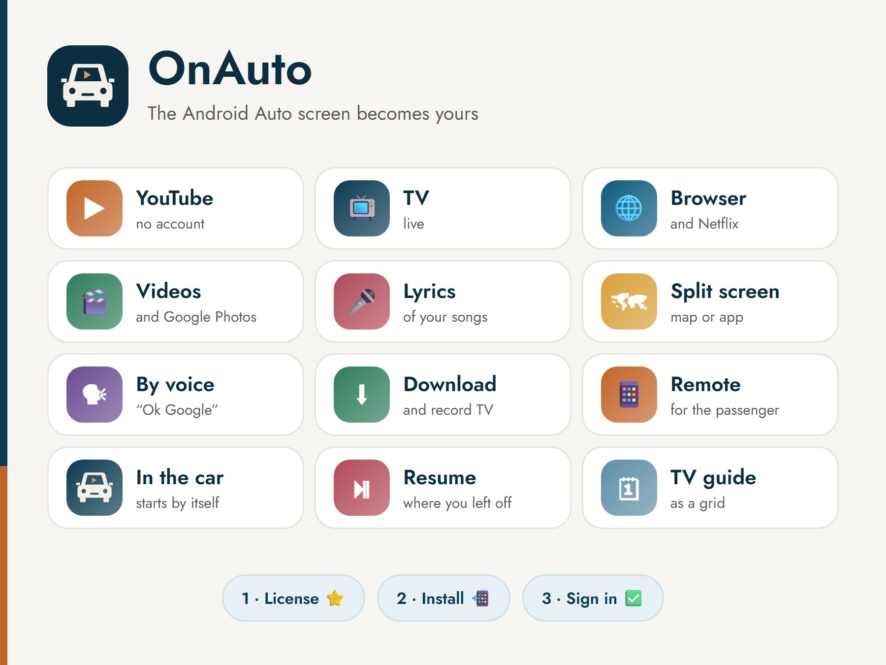
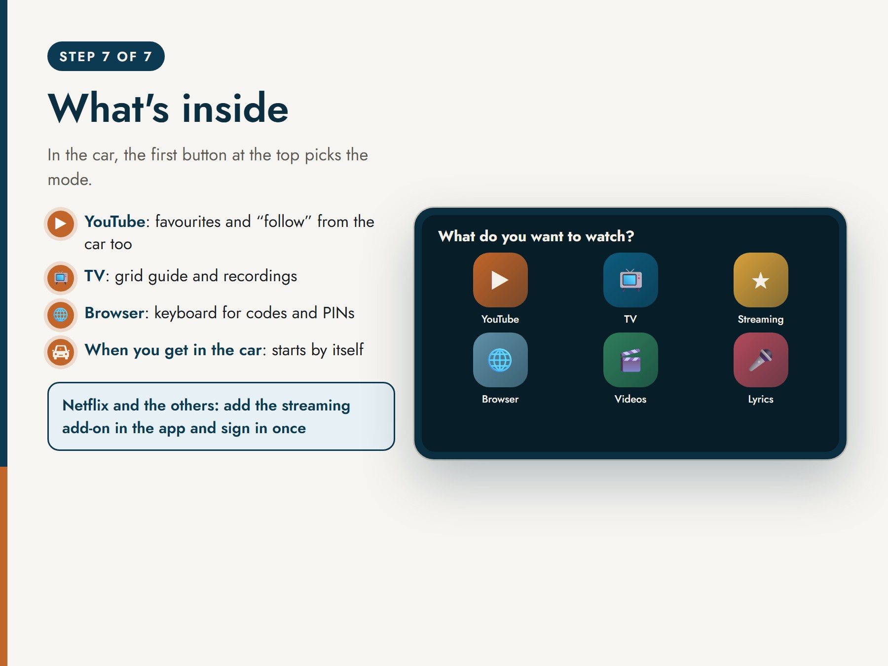
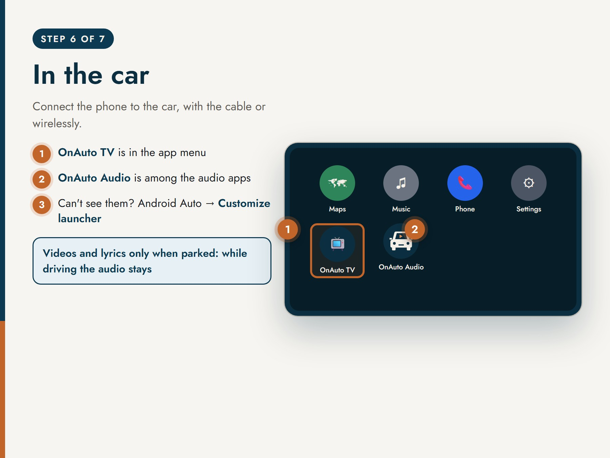

  

<h1 align="center">OnAuto</h1>

  <b>The Android Auto screen becomes yours.</b> 
  YouTube, live TV, your streaming services, your phone's videos, the browser and song lyrics on the car screen.

  <a href="https://t.me/OnAutoCylBot"><b>Try it free for 24 hours on Telegram → @OnAutoCylBot</b></a> 
  <a href="README.md">Italiano</a>

---

> **Source code is not public.** This repository presents the project and its features. OnAuto's code, apps and services are proprietary: see [LICENSE](LICENSE).

## What it does

OnAuto adds two apps to Android Auto:

- **OnAuto TV**, in the app menu: videos, TV, browser and lyrics on the car screen.
- **OnAuto Audio**, among the media apps: audio, TV channels and search, also while driving.

### In the car
| | |
|---|---|
| ▶️ **YouTube** | Search, followed channels, favourites and history, no account needed. Every video resumes where you left off; star and "follow" from the car too. |
| 📺 **Live TV** | Free-to-air Italian TV is ready, or add your own M3U lists. Grid programme guide with descriptions, channels in the order you like. |
| 🌐 **Netflix and streaming** | Netflix, Disney+, Prime Video and the others open in the car with **your** subscription, thanks to the add-on. Ad blocking on websites. |
| 🎬 **Videos** | From your phone, Google Photos or a link. |
| 🎤 **Song lyrics** | The lyrics of the song playing on Spotify or another app, in sync. |
| 🗺️ **Map beside the video** | Google Maps (or a simple map) next to video, TV, browser and lyrics. One choice for every mode, adjustable size, exceptions where you want. |
| 🗣️ **By voice** | "Ok Google, play Rai 1 on OnAuto": TV, videos, Netflix, lyrics, YouTube. |

### Before you leave
| | |
|---|---|
| ⬇️ **Offline videos** | Download videos from YouTube and many sites, record TV now, at a set time or from the guide. Queue, quality, "Wi‑Fi only". |
| 📱 **Passenger remote** | Whoever is with you scans a QR code and picks videos and channels, sets the volume, manages queue and favourites from their phone. Nothing to install. |

### When you get in the car
A routine starts by itself when the phone connects to the car (Bluetooth, a chosen Wi‑Fi network or Android Auto starting):

- hotspot on for passengers;
- voice greeting with the weather, phrases by day and time;
- music and navigation;
- passengers greeted by name;
- when you get out: parking position saved on the phone, with a note ("Where's my car");
- optional web calls on arrival and when parking (even only near a place, e.g. your home gate);
- import of **Tasker** projects.

### On the phone
- Settings grouped by when you need them, with each feature's status and a "How it works" page.
- In-app updates with one tap, keeping OnAuto TV in Android Auto.
- Optional settings backup on your Telegram account.
- Light, dark or system theme, holiday themes.
- Italiano, English, Español, Français, Deutsch.

## Safety

Videos and lyrics are shown **only while parked**: while driving the audio keeps playing.

## How to get it

Everything goes through the Telegram bot **[@OnAutoCylBot](https://t.me/OnAutoCylBot)**:

1. **Step-by-step guide** to install the app and enable it for Android Auto (about 10 minutes, only once, no root and no computer).
2. **Sign in** in the app with your Telegram account, no email or password.
3. **24-hour free trial**, then a license with Telegram Stars: 1 month, 1 year or 3 years.
4. **Support** right in the chat; from the app you can send your log with "Send log".

**Requirements:** an Android 11 or newer phone with Android Auto. For Android 10 and older the guide explains how to do it with a computer.

## Privacy

- No account besides Telegram; followed channels, favourites, history, parking positions and routine settings stay on the phone.
- The settings backup on your account is optional and encrypted.
- The app only sends technical phone data to the server (model, versions) and, if you choose, the log for support.

Full terms and privacy policy are in the bot (/termini, /privacy).

## Good to know

- Streaming services need **your own account with an active plan**: OnAuto doesn't include subscriptions, it only lets you watch them in the car.
- Service names (Netflix, Disney+, Prime Video, YouTube, Spotify, Google Maps…) are trademarks of their respective owners. OnAuto is not affiliated with or endorsed by them, nor by Google for Android Auto.

---

© 2026 OnAuto · All rights reserved

