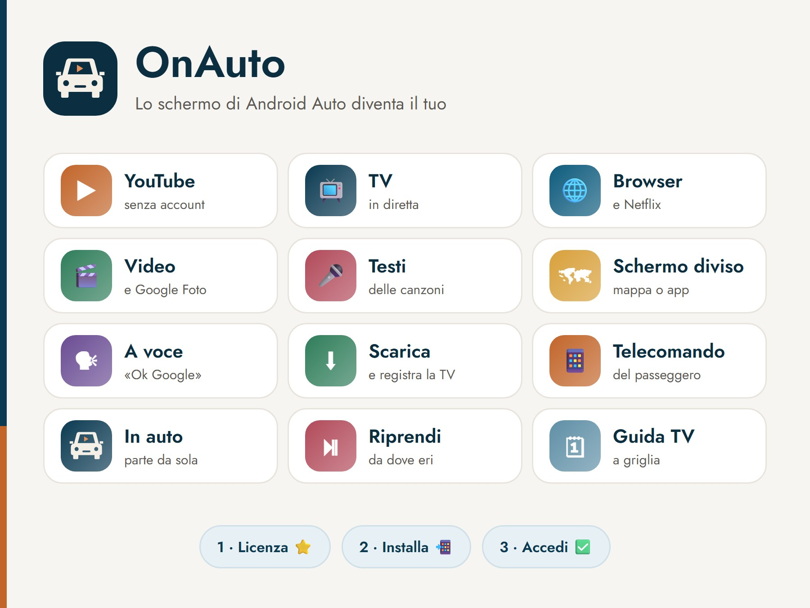
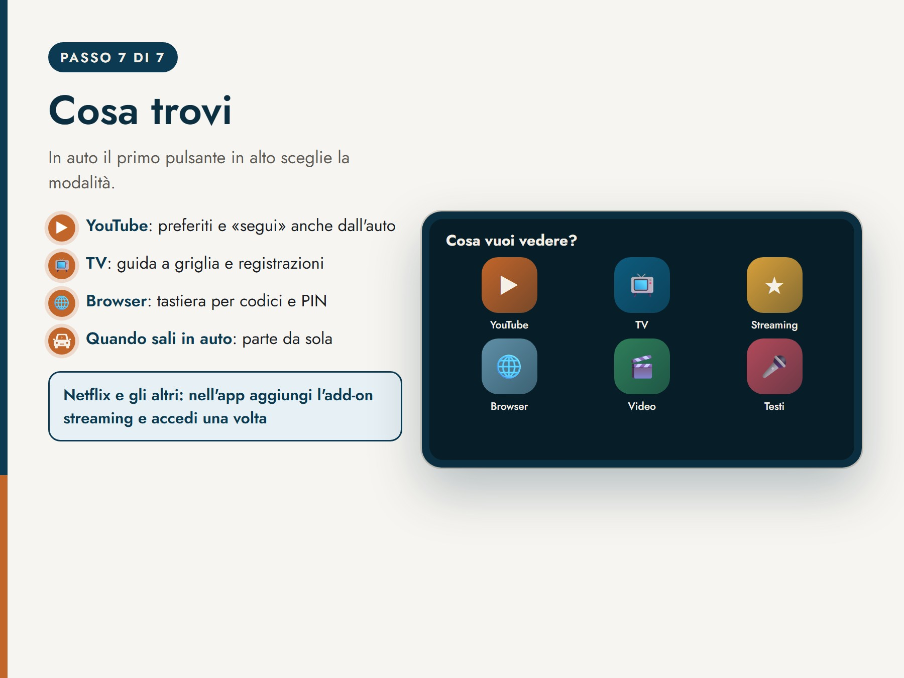
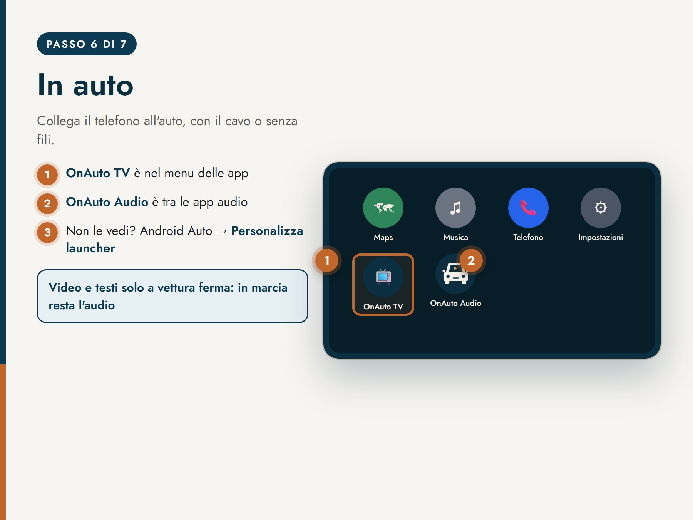

  

<h1 align="center">OnAuto</h1>

  <b>Lo schermo di Android Auto diventa il tuo.</b> 
  YouTube, TV in diretta, i tuoi servizi di streaming, i video del telefono, il browser e i testi delle canzoni sullo schermo dell'auto.

  <a href="https://t.me/OnAutoCylBot"><b>Provalo gratis 24 ore su Telegram → @OnAutoCylBot</b></a> 
  <a href="README.en.md">English</a>

---

> **Codice sorgente non pubblico.** Questo repository presenta il progetto e le sue funzioni. Il codice, le app e i servizi di OnAuto sono proprietari: vedi [LICENSE](LICENSE).

## Cosa fa

OnAuto aggiunge ad Android Auto due app:

- **OnAuto TV**, nel menu delle app: video, TV, browser e testi sullo schermo dell'auto.
- **OnAuto Audio**, tra le app multimediali: audio, canali TV e ricerca, anche in marcia.

### In auto
| | |
|---|---|
| ▶️ **YouTube** | Ricerca, canali seguiti, preferiti e cronologia, senza account. Ogni video riparte da dove l'avevi lasciato; stella e «segui» anche dall'auto. |
| 📺 **TV in diretta** | La TV in chiaro è già pronta, oppure aggiungi le tue liste M3U. Guida programmi a griglia con le descrizioni, canali nell'ordine che vuoi. |
| 🌐 **Netflix e streaming** | Netflix, Disney+, Prime Video e gli altri si aprono in auto con il **tuo** abbonamento, grazie all'add-on. Blocco della pubblicità nei siti. |
| 🎬 **Video** | Del telefono, di Google Foto o da un link. |
| 🎤 **Testi delle canzoni** | Il testo del brano che ascolti su Spotify o su un'altra app, sincronizzato. |
| 🗺️ **Mappa accanto al video** | Google Maps (o una mappa semplice) a fianco di video, TV, browser e testi. Una scelta per tutte le modalità, grandezza regolabile, eccezioni dove vuoi. |
| 🗣️ **A voce** | «Ok Google, metti Rai 1 su OnAuto»: TV, video, Netflix, testi, YouTube. |

### Prima di partire
| | |
|---|---|
| ⬇️ **Video senza rete** | Scarica i video di YouTube e di molti siti, registra la TV adesso, a un'ora scelta o dalla guida. Coda, qualità, «solo con il Wi‑Fi». |
| 📱 **Telecomando del passeggero** | Chi è con te inquadra un QR e dal suo telefono sceglie video e canali, regola il volume, gestisce coda e preferiti. Senza installare niente. |

### Quando sali in auto
La routine parte da sola quando il telefono si collega all'auto (Bluetooth, una rete Wi‑Fi scelta o l'avvio di Android Auto):

- hotspot acceso per i passeggeri;
- saluto vocale con il meteo, frasi per giorno e orario;
- musica e navigatore;
- saluto ai passeggeri per nome;
- quando scendi: posizione del parcheggio salvata sul telefono, con nota («Dov'è l'auto»);
- chiamate web facoltative all'arrivo e alla sosta (anche solo vicino a un posto, per esempio il cancello di casa);
- importazione dei progetti di **Tasker**.

### Sul telefono
- Impostazioni ordinate per momento d'uso, con lo stato di ogni funzione e una pagina «Come funziona».
- Aggiornamenti dall'app con un tocco, senza perdere OnAuto TV in Android Auto.
- Copia delle impostazioni sul tuo account Telegram (facoltativa).
- Tema chiaro, scuro o come il sistema, temi delle feste.
- Italiano, English, Español, Français, Deutsch.

## Sicurezza

Video e testi si vedono **solo a vettura ferma**: in marcia continua l'audio.

## Come si ottiene

Tutto passa dal bot Telegram **[@OnAutoCylBot](https://t.me/OnAutoCylBot)**:

1. **Guida passo passo** per installare l'app e attivarla per Android Auto (circa 10 minuti, una volta sola, senza root e senza computer).
2. **Accesso** nell'app con il tuo account Telegram, senza email né password.
3. **Prova gratuita di 24 ore**, poi la licenza con le Telegram Stars: 1 mese, 1 anno o 3 anni.
4. **Assistenza** direttamente in chat; dall'app puoi mandare il registro con «Invia log».

**Requisiti:** telefono Android 11 o più recente con Android Auto. Per Android 10 e precedenti la guida spiega come fare con un computer.

## Privacy

- Nessun account oltre a Telegram; canali seguiti, preferiti, cronologia, posizioni del parcheggio e impostazioni della routine restano sul telefono.
- La copia delle impostazioni sul tuo account è facoltativa e cifrata.
- L'app manda al server solo dati tecnici del telefono (modello, versioni) e, se lo scegli tu, il registro per l'assistenza.

Termini e informativa completi sono nel bot (/termini, /privacy).

## Da sapere

- Per i servizi di streaming serve **il tuo account con un piano attivo**: OnAuto non include abbonamenti, permette solo di guardarli in auto.
- I nomi dei servizi (Netflix, Disney+, Prime Video, YouTube, Spotify, Google Maps…) sono marchi dei rispettivi proprietari. OnAuto non è affiliato né approvato da loro, né da Google per Android Auto.

---

© 2026 OnAuto · Tutti i diritti riservati

